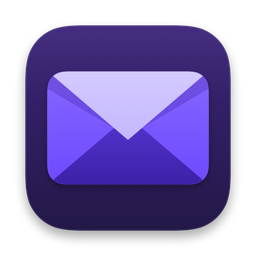
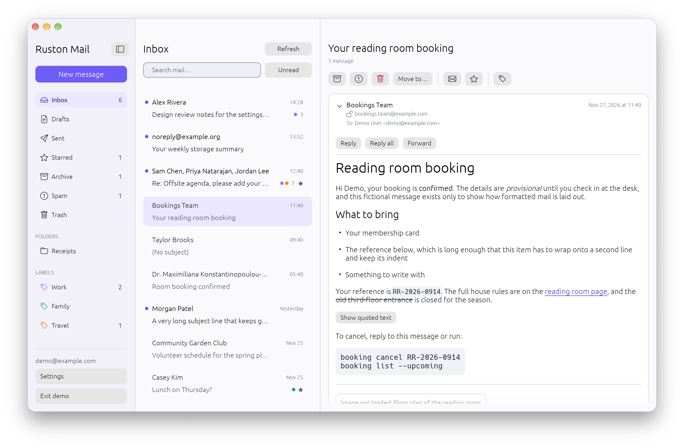
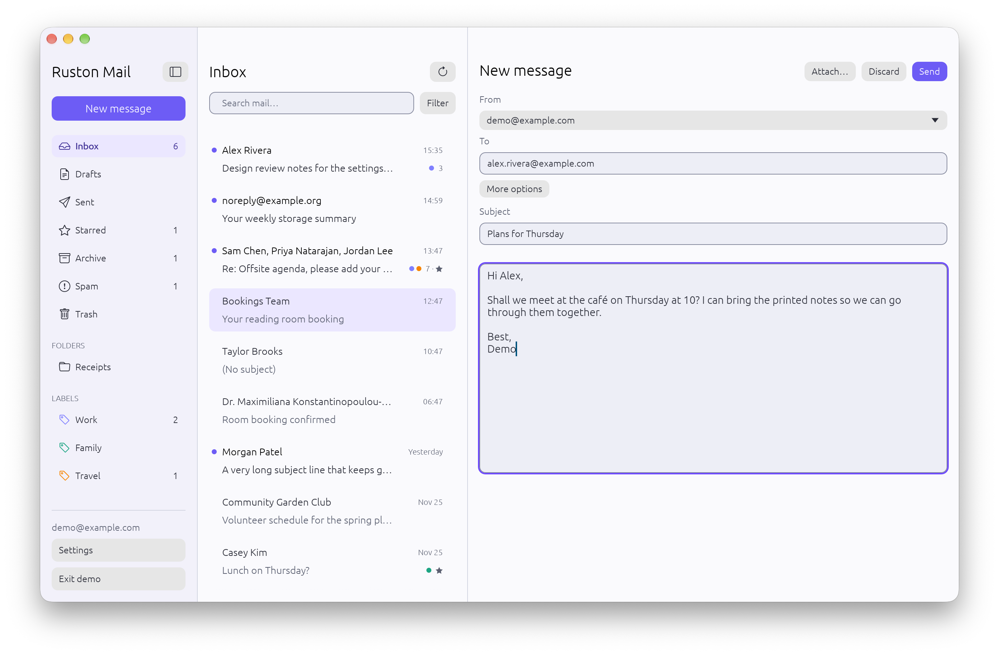
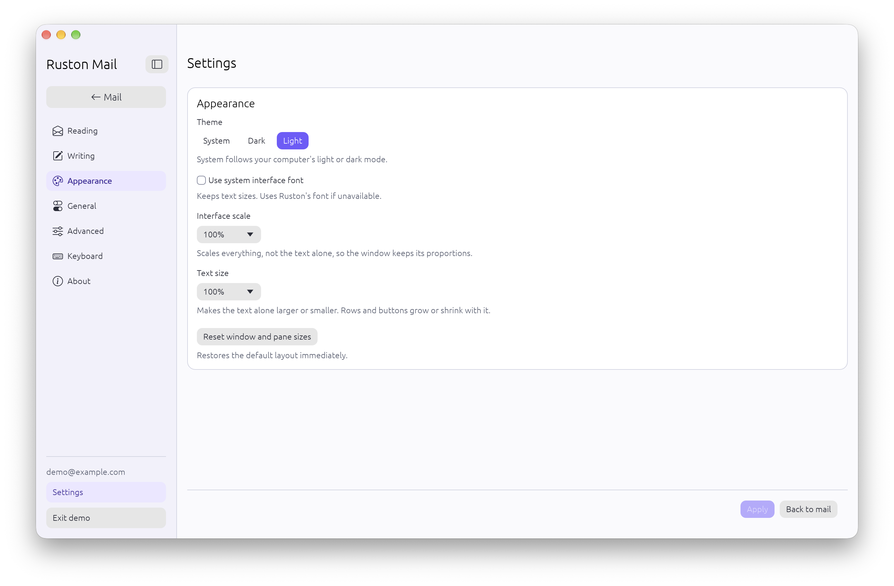
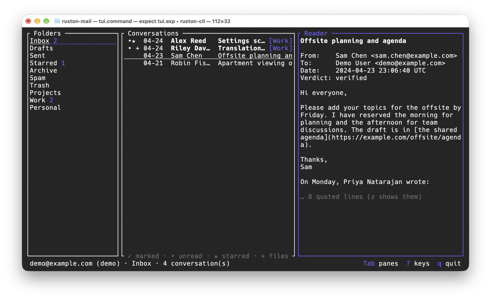

<div align="center">
  
  <h1>Ruston Mail</h1>

  <p><strong>An unofficial desktop client for Proton Mail, written in Rust.</strong></p>
  <p><a href="https://github.com/luiscuellar31/ruston-mail/releases/latest"></a></p>
  <p><a href="#download">Download</a> · <a href="#features">Features</a> · <a href="#screenshots">Screenshots</a> · <a href="#documentation">Documentation</a></p>

  <picture>
    <source media="(prefers-color-scheme: dark)" srcset="assets/screenshots/main-window-dark.png">
    <source media="(prefers-color-scheme: light)" srcset="assets/screenshots/main-window-light.png">
    
  </picture>
</div>

Ruston Mail lets you read, organize, and write your Proton Mail in a native
window, with no browser inside it. It runs on macOS, Windows, and Linux, and
comes with `ruston-cli`, a command-line client for the same accounts that can
also open a full-screen terminal interface. It is still in beta, so expect some
rough edges.

> Ruston Mail is not affiliated with or endorsed by Proton AG.

## Features

- **Accounts:** sign in to up to five Proton accounts and switch between them.
  Two-factor codes, a separate mailbox password, and Proton's human
  verification all work.
- **Finding mail:** folders and labels with unread counts, filters for unread
  or read mail and mail with attachments, newest or oldest first, a field that
  narrows the list as you type, and search across the whole mailbox.
- **Reading:** plain-text and HTML mail, with threads, quoted replies, tables,
  and the pictures a message carries. Save attachments wherever you like.
- **Writing:** new messages, replies, and forwards, with attachments. Ruston
  Mail can also open email links from other apps.
- **Organizing:** archive, star, label, mark read or unread, or move mail to
  Spam or Trash, and undo a move. Choose several conversations to archive,
  move, star, or mark them read together.
- **Staying informed:** notifications for new mail, and an unread count on the
  app's icon.
- **Making it yours:** a light or dark look, or your system's on macOS and
  Windows, interface zoom, and keyboard shortcuts.
- **Private by default:** mail stays in memory, pictures from the web are never
  loaded, and links ask before they open. The app talks only to Proton, and to
  GitHub only if you turn on update checks.

## Screenshots

<p align="center">
  <picture>
    <source media="(prefers-color-scheme: dark)" srcset="assets/screenshots/compose-dark.png">
    <source media="(prefers-color-scheme: light)" srcset="assets/screenshots/compose-light.png">
    
  </picture>
  <picture>
    <source media="(prefers-color-scheme: dark)" srcset="assets/screenshots/settings-dark.png">
    <source media="(prefers-color-scheme: light)" srcset="assets/screenshots/settings-light.png">
    
  </picture>
  
</p>

## Limitations

The desktop app can't save drafts or sign in with a security key yet, and it
can't create, rename, or delete folders and labels. It can move mail to Trash,
but it never deletes anything for good. The [user guide](docs/USAGE.md) has the
details, and the [roadmap](#roadmap) says what comes first.

## Download

Pick the file for your system from the
[latest release](https://github.com/luiscuellar31/ruston-mail/releases/latest).

| Platform | File |
| --- | --- |
| macOS 11 or later, Apple Silicon | `ruston-mail-<version>-arm64-UNSIGNED.dmg` |
| macOS 11 or later, Intel | `ruston-mail-<version>-x86_64-UNSIGNED.dmg` |
| Linux x86_64, glibc 2.35 or later | `ruston-mail-<version>-x86_64.AppImage` |
| Linux ARM64, glibc 2.35 or later | `ruston-mail-<version>-aarch64.AppImage` |
| Windows 10 or later, x86_64 | `ruston-mail-<version>-x86_64-setup-UNSIGNED.exe` |
| Windows 10 or later, x86_64, portable | `ruston-mail-<version>-x86_64-windows-UNSIGNED.zip` |
| Windows 10 or later, ARM64 | `ruston-mail-<version>-arm64-setup-UNSIGNED.exe` |
| Windows 10 or later, ARM64, portable | `ruston-mail-<version>-arm64-windows-UNSIGNED.zip` |

Every release also includes a `SHA256SUMS.txt`. To check that a download
arrived intact, run this in the folder that holds both files:

```sh
shasum -a 256 -c SHA256SUMS.txt --ignore-missing   # macOS
sha256sum -c SHA256SUMS.txt --ignore-missing       # Linux
```

On Windows, PowerShell prints `True` when the file matches:

```powershell
$file = 'ruston-mail-<version>-x86_64-setup-UNSIGNED.exe'
(Get-FileHash $file).Hash -eq (-split (Select-String -Path SHA256SUMS.txt -SimpleMatch "  $file").Line)[0]
```

A checksum catches a damaged download, not a replaced one. To confirm that a
file was built by this repository's release workflow, use the
[GitHub CLI](https://cli.github.com/):

```sh
gh attestation verify ruston-mail-<version>-x86_64.AppImage --repo luiscuellar31/ruston-mail
```

### macOS

Open the DMG and drag Ruston Mail to Applications. The app isn't notarized by
Apple, so macOS blocks it the first time: allow it once under **System
Settings → Privacy & Security → Open Anyway**.

### Linux

The AppImage runs on Ubuntu 22.04, Debian 12, Fedora 36, and anything newer.
Make it executable, then start it:

```sh
chmod +x ruston-mail-<version>-x86_64.AppImage
./ruston-mail-<version>-x86_64.AppImage
```

### Windows

Run the setup file. It installs Ruston Mail for your user, without
administrator rights, and adds it to the Start menu. It can also make Ruston
Mail open email links and put `ruston-cli` on your `PATH`.

The files aren't signed, so SmartScreen may say it protected your PC: choose
**More info**, then **Run anyway**. Windows with Smart App Control turned on
won't run unsigned apps.

To use Ruston Mail without installing it, extract the ZIP and start
`ruston.exe`. Its `README.txt` explains email links and how to remove it.

### Updates

Ruston Mail looks for a newer version only if you turn on **Check for updates**
under **Settings › About**. It then asks GitHub as it starts and once a day,
tells you when a newer release is out, and opens its page when you choose
**Download**: nothing is downloaded or installed for you.

## Command line

`ruston-cli` comes inside the app and uses the same sign-in:

- **macOS:** `Ruston Mail.app/Contents/MacOS/ruston-cli`
- **Linux:** pass `--cli` as the AppImage's first argument
- **Windows:** `ruston-cli.exe`, next to `ruston.exe` in
  `%LOCALAPPDATA%\Programs\Ruston Mail`

```sh
ruston-cli messages list --folder inbox
ruston-cli messages read <id>
ruston-cli --help
```

Run `ruston-cli` with no command, or `ruston-cli tui`, to open the terminal
interface, or `ruston-cli --demo tui` to try it with fictional mail. It writes
plain text and keeps the message you're writing in memory, never as a draft.
The [user guide](docs/USAGE.md#terminal-interface) lists its keys.

Its optional local search index keeps decrypted message bodies on disk,
unencrypted. The [user guide](docs/USAGE.md#command-line) covers that, putting
the CLI on your `PATH`, separate profiles, and exports.

## Build from source

You need Rust 1.96 or newer. With [rustup](https://rustup.rs), `cargo` picks
the toolchain named in `rust-toolchain.toml`, the same one CI and releases use,
and downloads it the first time.

```sh
git clone https://github.com/luiscuellar31/ruston-mail.git
cd ruston-mail
cargo run                          # the desktop app
RUSTON_DEMO=1 cargo run            # a fictional mailbox, no account needed
cargo run -p ruston-cli -- --help  # the command-line client
```

The demo never contacts Proton. The [development guide](docs/DEVELOPMENT.md)
covers PowerShell, Linux launchers, Windows builds, packaging, and releases.

## Documentation

- [Using Ruston Mail](docs/USAGE.md)
- [Privacy and local data](docs/PRIVACY.md)
- [Development](docs/DEVELOPMENT.md)
- [Architecture and code map](docs/ARCHITECTURE.md)
- [Contributing](CONTRIBUTING.md)

## Roadmap

- Save drafts in the desktop app.
- Create, rename, and delete folders and labels.
- Sign in with a security key.

## Contributing

Contributions are welcome. Read [CONTRIBUTING.md](CONTRIBUTING.md) before
opening a pull request: branch from `dev` and open the pull request against it.

## License

Ruston Mail is available under the [MIT License](LICENSE).
[`THIRD_PARTY_NOTICES.txt`](THIRD_PARTY_NOTICES.txt), which every package
carries, holds the notices of the software it ships with.
