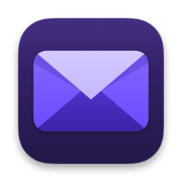

<div align="center">
  
  <h1>Ruston Mail</h1>

  <p><strong>An unofficial desktop client for Proton Mail, written in Rust.</strong></p>
</div>

Ruston Mail reads, organizes, and sends your Proton Mail in a native
three-pane window, without an embedded browser. It comes with `ruston-cli`, a
command-line client for the same account. The project is in early development.

> Ruston Mail is not affiliated with or endorsed by Proton AG.

## Features

- Sign in with TOTP, a separate mailbox password, or Proton's human
  verification.
- Browse folders and labels with unread counts; filter what is loaded as you
  type, or search the whole mailbox.
- Read plain-text and HTML mail, threads, and quoted replies, and save
  attachments.
- Write, reply, reply to all, and forward, with attachments.
- Archive, star, mark read or unread, label, and move to Spam or Trash; a move
  can be undone.
- Private by default: the desktop keeps mail in memory, blocks remote images,
  and asks before opening a link.

## Limitations

Saved drafts, security-key sign-in, and folder or label management are not
supported yet in the desktop client. It can move a message to Trash, but it
never permanently deletes mail. See the [user guide](docs/USAGE.md) for more
detail.

## Download

Get a release from the
[releases page](https://github.com/luiscuellar31/ruston-mail/releases).

| Platform | File |
| --- | --- |
| macOS 11 or later, Apple Silicon | `ruston-mail-<version>-arm64-UNSIGNED.dmg` |
| macOS 11 or later, Intel | `ruston-mail-<version>-x86_64-UNSIGNED.dmg` |
| Linux x86_64, glibc 2.35 or later | `ruston-mail-<version>-x86_64.AppImage` |
| Linux ARM64, glibc 2.35 or later | `ruston-mail-<version>-aarch64.AppImage` |
| Windows 10 or later, x86_64 | `ruston-mail-<version>-x86_64-setup-UNSIGNED.exe`, or the portable `ruston-mail-<version>-x86_64-windows-UNSIGNED.zip` |
| Windows 10 or later, ARM64 | `ruston-mail-<version>-arm64-setup-UNSIGNED.exe`, or the portable `ruston-mail-<version>-arm64-windows-UNSIGNED.zip` |

Every release publishes `SHA256SUMS.txt`. Check your download against it from
the folder that holds both:

```sh
shasum -a 256 -c SHA256SUMS.txt --ignore-missing   # macOS
sha256sum -c SHA256SUMS.txt --ignore-missing       # Linux
```

On Windows, compare the hash PowerShell prints with the file's line in
`SHA256SUMS.txt`:

```powershell
Get-FileHash .\ruston-mail-<version>-x86_64-setup-UNSIGNED.exe
```

**macOS:** open the DMG and drag Ruston Mail to Applications. The app is not
notarized, so macOS blocks its first launch: allow it once under **System
Settings → Privacy & Security → Open Anyway**.

**Linux:** the AppImage runs on Ubuntu 22.04, Debian 12, Fedora 36, and later.
Make it executable and start it:

```sh
chmod +x ruston-mail-<version>-x86_64.AppImage
./ruston-mail-<version>-x86_64.AppImage
```

**Windows:** run the setup file. It installs for your user without
administrator rights and adds Ruston Mail to the Start menu; it can also offer
Ruston Mail for email links and put `ruston-cli` on your `PATH`. The files are
not signed, so SmartScreen may say that it protected your PC: choose **More
info**, then **Run anyway**. Windows with Smart App Control turned on does not
run unsigned apps. To use Ruston Mail without installing it, extract the ZIP
and start `ruston.exe`; its `README.txt` covers email links and removal.

## Command line

`ruston-cli` ships inside the app and shares its session. On macOS it is
`Ruston Mail.app/Contents/MacOS/ruston-cli`; on Linux, pass `--cli` as the
AppImage's first argument; on Windows it is `ruston-cli.exe`, beside
`ruston.exe` in `%LOCALAPPDATA%\Programs\Ruston Mail`.

```sh
ruston-cli messages list --folder inbox
ruston-cli messages read <id>
ruston-cli --help
```

Its optional local search index keeps decrypted message bodies on disk,
unencrypted. The [user guide](docs/USAGE.md#command-line) covers that, putting
the CLI on your `PATH`, separate profiles, and exports.

## Build from source

You need Rust 1.96 or newer.

```sh
git clone https://github.com/luiscuellar31/ruston-mail.git
cd ruston-mail
cargo run                          # the desktop app
RUSTON_DEMO=1 cargo run            # a fictional mailbox, no account needed
cargo run -p ruston-cli -- --help  # the command-line client
```

The demo never contacts Proton. The
[development guide](docs/DEVELOPMENT.md) covers PowerShell, Linux launchers,
Windows builds, packaging, and releases.

## Documentation

- [Using Ruston Mail](docs/USAGE.md)
- [Privacy and local data](docs/PRIVACY.md)
- [Development](docs/DEVELOPMENT.md)
- [Architecture and code map](docs/ARCHITECTURE.md)
- [Contributing](CONTRIBUTING.md)

## License

Ruston Mail is available under the [MIT License](LICENSE). `ruston-core` and
`ruston-cli` are adapted from Filippo Finke's
[`protonmail-rs`](https://github.com/filippofinke/protonmail-rs).
